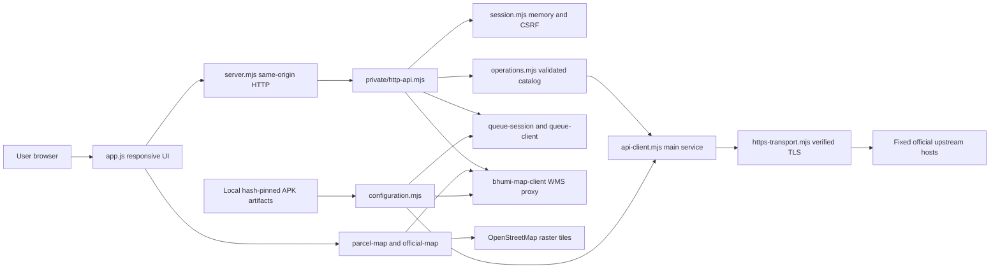

# Architecture checkpoint

This repository is an independent browser reconstruction informed by bounded static audits of Sentuh Tanahku 6.1.5. It is a source checkpoint, not a claim of complete application parity or production transaction acceptance. Source verification, synthetic fixtures, Android observations and earlier live observations are separate evidence categories. No deployment or account mutation is performed by the architecture mapping workflow.

## Runtime and trust boundaries

The application has no npm runtime dependencies or frontend build step. `webapp/index.html` loads the browser modules, while `webapp/server.mjs` uses Node's HTTP server to serve a fixed public allowlist and dispatch private API routes. `webapp/package.json` declares the supported Node version and local test commands.

`private/browser-origin.mjs` validates the exact Host and browser Origin. `private/session.mjs` keeps account/session state in server memory and provides host-only cookies and CSRF checks. The HTTP API binds sessions to an origin. Frontend route, session and source-response ownership guards suppress stale completions; they are browser lifecycle adaptations, not proof of native framework equivalence.

`private/configuration.mjs` derives required runtime configuration in memory from locally supplied ELF/pool artifacts with fixed hashes. Those artifacts, extracted credentials, TLS identities, account tokens and local environment values are not published in this source checkpoint. A clone without the separately provisioned original artifacts cannot establish the live upstream configuration. The server public allowlist does not serve `private/`, scripts, analysis or environment files.

`private/https-transport.mjs` implements bounded HTTPS requests, timeouts and transport diagnostics. Configuration scopes APK-derived TLS identity/trust to the audited hosts; certificate and hostname verification stay enabled. Logs contain bounded metadata rather than credentials or request/response bodies. Configured transport and a healthy localhost server do not establish upstream acceptance.

## Frontend, request adapters and feature state

`webapp/app.js` owns routes, authenticated profile gates, forms, record lists, details, dialogs and local request ownership. It imports `gnss.js`, `coordinate-comparison.js` and `parcel-map.js`. The API client executes enabled, explicitly registered operations rather than a general arbitrary URL proxy. `operations-runtime.mjs` supplies the validation/runtime functions appended to the generated `operations.mjs`; `build-operations.py` is the generator source.

Public feed, account, search, document, office, service-information, queue and collection flows use dedicated response validation where audited. Specialized modules include `news-response.mjs`, `scan-response.mjs`, `collection-response.mjs`, `queue-models.mjs` and `queue-calls-models.mjs`. Runtime-disabled or partially mapped operations remain limitations; a catalog schema count is not a completed-feature count.

The BERKAS bookmark control is wired in shared Search, Activity and Collection detail paths. It has no editable NIK form: `app.js` sends the three derived metadata fields, while `private/api-client.mjs` obtains `Nik` only from the stored sign-in user field. Initial collection status uses response `message`; save uses response `data`. Valid typed HTTP200 envelopes are handled according to the audited caller, including native label/ID divergence for empty save data. The Collection success callback uses a non-forced rows read, not a rows-plus-groups refresh. Berkasku retains its distinct rating branch.

Group creation, assignment, group deletion, membership removal, item deletion and caption editing have different cache effects. Assignment/removal refresh rows and groups; group deletion filters groups locally; item deletion filters a pre-request rows snapshot; caption editing maps the current rows list and preserves the audited local `groupId:null` clone behavior. The server's membership/cascade behavior is not inferred from those local effects.

Activity deletion uses the native post-await local removal behavior even when ordinary server acceptance is not confirmed. Its scoped backend response parser is distinct from collection scalar envelopes. Synthetic tests keep that distinction visible rather than equating a local UI disappearance with server deletion.

**Staged PERSIL module:** `webapp/collection-save-persil.js` implements a tested save/group-selection controller with an injected host adapter. It is served by the static allowlist and has focused tests, but `app.js` does not import or wire it into the visible product flow at this checkpoint. Its existence does not mean PERSIL saving is available from the current UI.

## Map and coordinate paths

`parcel-map.js` derives an initial camera, bounds and reference pin from server feature data. `webapp/assets/maps/official-map.js` mounts the raster OpenStreetMap base and the Bhumi WMS boundary overlay, fitting the extent and limiting the initial zoom. The displayed pin is an acuan/reference point from returned geometry, not a survey boundary or independent accuracy certificate.

OpenStreetMap tiles are loaded from their raster tile endpoint with attribution. Bhumi tiles use the same-origin `/api/maps/bhumi/{z}/{x}/{y}.png` route and `private/bhumi-map-client.mjs`; Bhumi credentials stay in the backend. `browser-map-configuration.mjs` controls the browser map configuration and CSP. Bundled map-library vendor code and artwork are excluded from this Graphify map, while authored `official-map.js` is included.

`gnss.js` parses and normalizes supplied coordinates; `coordinate-comparison.js` computes local comparisons. These local tools do not replace evidence of physical attendance. Geotag upload remains disabled/official-app-required, and this checkpoint does not implement a visit bypass, fabricated positioning or remote attestation.

## Tests, publication and evidence

`webapp/tests/*.test.mjs` contains Node transport, backend, model, ownership and actual-function VM UI tests. Separate `*-browser-fixture.mjs` files provide synthetic local browser surfaces. Those fixtures are development tools rather than product entry points; their successful responses do not prove original server behavior. Test fixtures do not need production credentials.

`scripts/` contains launch/stop/package utilities, extraction/audit verification and emulator inventory/install helpers. Docker configuration binds localhost and supports read-only frontend mounts; Cloudflare configuration is documented in `DOCKER.md`. The checkpoint does not start or rebuild any deployment.

Selected human-readable audits remain under `analysis/`. Raw XAPK/APK/ELF/pool dumps, local runtime evidence, credentials and tool environments are omitted from publication. `docs/SOURCE-MANIFEST.json` records the copied source snapshot; it is a publication inventory, not live-server validation. Historical release documents remain historical and may describe earlier source/deployment counts.

## Graphify map provenance

The architecture graph is generated with the installed TypeScript Graphify 0.17.1 runtime and actual AST extraction, plus assistant semantic extraction for these architecture documents. `.graphifyignore` bounds the graph to production sources, tests, scripts and selected documentation. The entire analysis archive, vendored libraries, icons, binary artifacts and font/image assets are excluded from graph extraction; excluded analysis documents may still be committed as reference material.

The actual AST pass detects eight PowerShell scripts but cannot parse them because `tree-sitter-powershell` is unavailable in this installed runtime. Their inclusion in the inventory or documentation does not certify internal call relationships. JavaScript, MJS backend/tests and Python sources are structurally extracted; no parser or package installation is performed to conceal the PowerShell gap.

Outputs are `.graphify/graph.json`, `.graphify/GRAPH_REPORT.md`, `.graphify/manifest.json` and `.graphify/studio/studio.html`. The Studio export is self-contained for offline review. `.graphify/.graphify_runtime.json` records the TypeScript runtime proof; `.graphify/portable-check.json` records the portability check. Semantic relationships are marked EXTRACTED, INFERRED or AMBIGUOUS; the map does not certify runtime coverage, security completeness, pixel parity or production acceptance.
